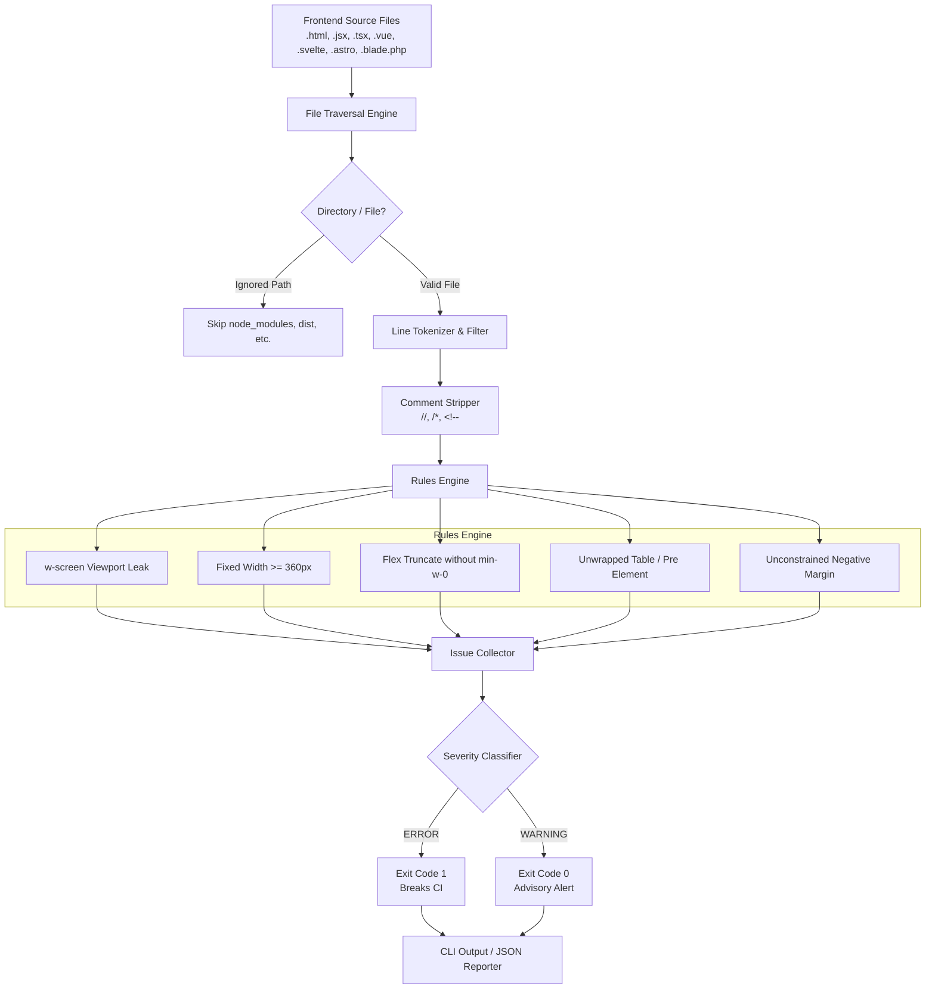

# Architecture: zero-overflow-ui

## Overview

`zero-overflow-ui` is built with a zero-dependency static analysis architecture. It parses frontend templates line-by-line, matching layout-breaking CSS declarations and Tailwind utility classes against a deterministic violation taxonomy.

## System Architecture Diagram

## Core Design Decisions

1. **Zero External Dependencies**:
   * Uses native `node:fs` and `node:path`.
   * No heavy dependencies like PostCSS, Babel, or AST compilers that bloat `node_modules` by 50MB+.
   * Execution completes in milliseconds, making it suitable for pre-commit hooks and CI pipelines.

2. **Stream-based Scanning**:
   * Files are processed synchronously line by line to keep memory consumption under 20MB even across enterprise projects with thousands of components.

3. **Configurable Severity**:
   * `ERROR`: Fatal layout bugs guaranteed to break horizontal scroll on mobile devices (e.g. `w-screen`, `w-[500px]`). Exits with code `1`.
   * `WARNING`: Structural risks that require parent context verification (e.g. `truncate` without `min-w-0`, uncontained tables). Exits with code `0` unless strict mode is enabled.
