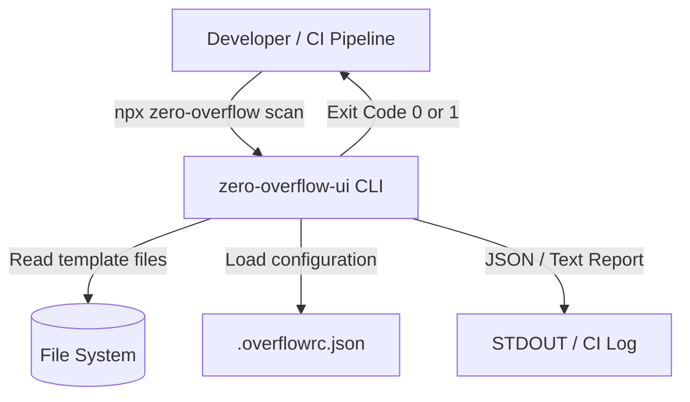
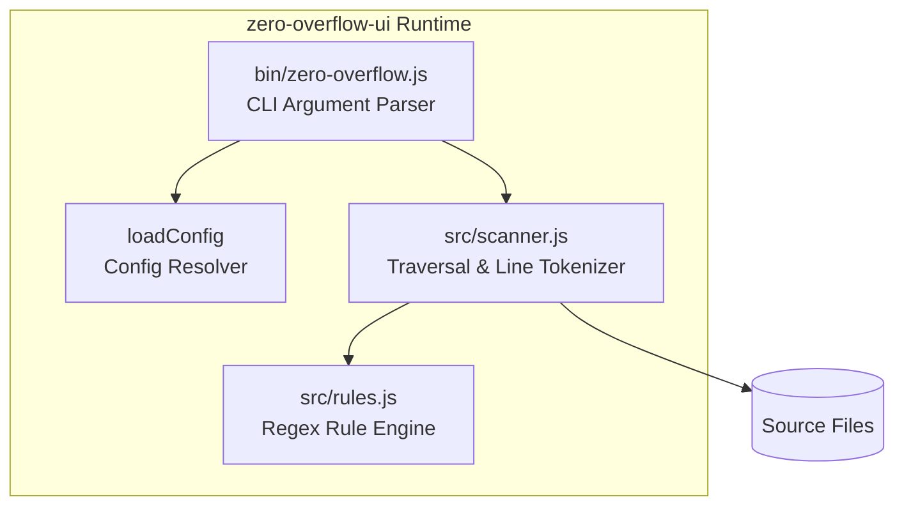
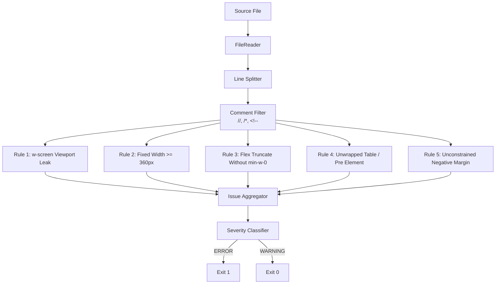

Architecture: zero-overflow-ui

`zero-overflow-ui` implements a zero-dependency, single-pass static scanner designed to eliminate horizontal viewport overflow on compact mobile devices (viewports < 360px).

1. C4 Architecture Model

Level 1: System Context Diagram



Level 2: Container Diagram



Level 3: Component Diagram



2. Sequence Diagram (Execution Flow)

```mermaid
sequenceDiagram
    autonumber
    actor Dev as Developer / CI
    participant CLI as bin/zero-overflow.js
    participant FS as File System
    participant Core as src/scanner.js
    participant Rules as src/rules.js

    Dev->>CLI: npx zero-overflow scan src/
    CLI->>FS: Load .overflowrc.json
    FS-->>CLI: Return config object
    CLI->>Core: scanDirectory(dirPath, config)
    loop Every Source File (.html, .tsx, .vue, .blade.php, etc.)
        Core->>FS: readFileSync(filePath, 'utf-8')
        FS-->>Core: Raw file content
        loop Every Line
            Core->>Core: Filter out comments (//, /*, &lt;!--)
            Core->>Rules: check(line, index, allLines)
            Rules-->>Core: IssueResult or null
        end
    end
    Core-->>CLI: Array of IssueResult
    CLI->>Dev: Print colorized summary & return exit code (0 or 1)
```

3. Mathematical & Layout Invariants

Mobile Viewport Inequality
Modern compact mobile devices specify a logical viewport width:

$$W_{\text{viewport}} \in [360\text{px}, 390\text{px}]$$

Any element rendered with a rigid physical width $W_{\text{elem}}$:

$$W_{\text{elem}} \ge 360\text{px}$$

violates the containment boundary unless qualified by a responsive media query breakpoint ($M \in \{\text{sm}, \text{md}, \text{lg}, \text{xl}\}$).

Scrollbar Width Invariant (`w-screen`)
Tailwind `w-screen` resolves to `width: 100vw`. In standard CSS box models:

$$100\text{vw} = W_{\text{viewport}} + W_{\text{scrollbar}}$$

When a vertical scrollbar is present, $W_{\text{scrollbar}} \approx 15\text{px}-17\text{px}$, causing:

$$W_{\text{rendered}} > W_{\text{client}}$$

which triggers involuntary horizontal scrolling. `zero-overflow-ui` enforces replacing `w-screen` with `w-full`.

4. Complexity & Performance

- Time Complexity: $O(N \times L \times R)$ where:
  - $N$ is total number of frontend template files.
  - $L$ is average lines per file.
  - $R$ is total active rules (constant 5).
  - Overall time complexity is strictly linear $O(\text{Total Lines})$.
- Space Complexity: $O(L_{\text{max}})$ where $L_{\text{max}}$ is the length of the longest line in the codebase.
- Memory Overhead: < 15MB RSS memory during cold runs.
