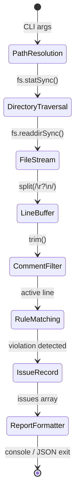

# Data Flow Architecture: zero-overflow-ui

Detailed breakdown of data transformations and token state machines in `zero-overflow-ui`.

## 1. Pipeline Stages



## 2. Token Matching State Machine

When `scanFile` evaluates a source file:

```
[Line Input]
   │
   ├─ Empty Line? ─────────────────────────► [Skip]
   ├─ Starts with '//' or '/*' or '<!--'? ──► [Skip]
   │
   └─ Clean Code Line
         │
         ├─ Regex 1: /w-screen\b/
         │     └─ Match? ──► Emit viewport-width-leak (ERROR)
         │
         ├─ Regex 2: /w-\[(\d+)px\]/
         │     └─ Pixels >= 360? ──► Emit fixed-width-overflow (ERROR)
         │
         ├─ Regex 3: /truncate\b/
         │     └─ Missing min-w-0 on flex child? ──► Emit flex-truncate-leak (WARNING)
         │
         ├─ Regex 4: /<(table|pre)\b/
         │     └─ Preceding line lacks overflow-x-auto? ──► Emit table-pre-unwrapped (WARNING)
         │
         └─ Regex 5: /-mx-(?:4|6|8|10|12|16)\b/
               └─ Unclipped negative margin? ──► Emit negative-margin-leak (WARNING)
```

## 3. Data Structures

### Line Context Window
Rules like `flex-truncate-leak` and `table-pre-unwrapped` consume contextual sibling lines:
- **Lookback Window**: $N - 1$ inspection for table/code parent containers.
- **Lookaround Window**: Scanning parent and sibling flex declarations across adjacent lines.
